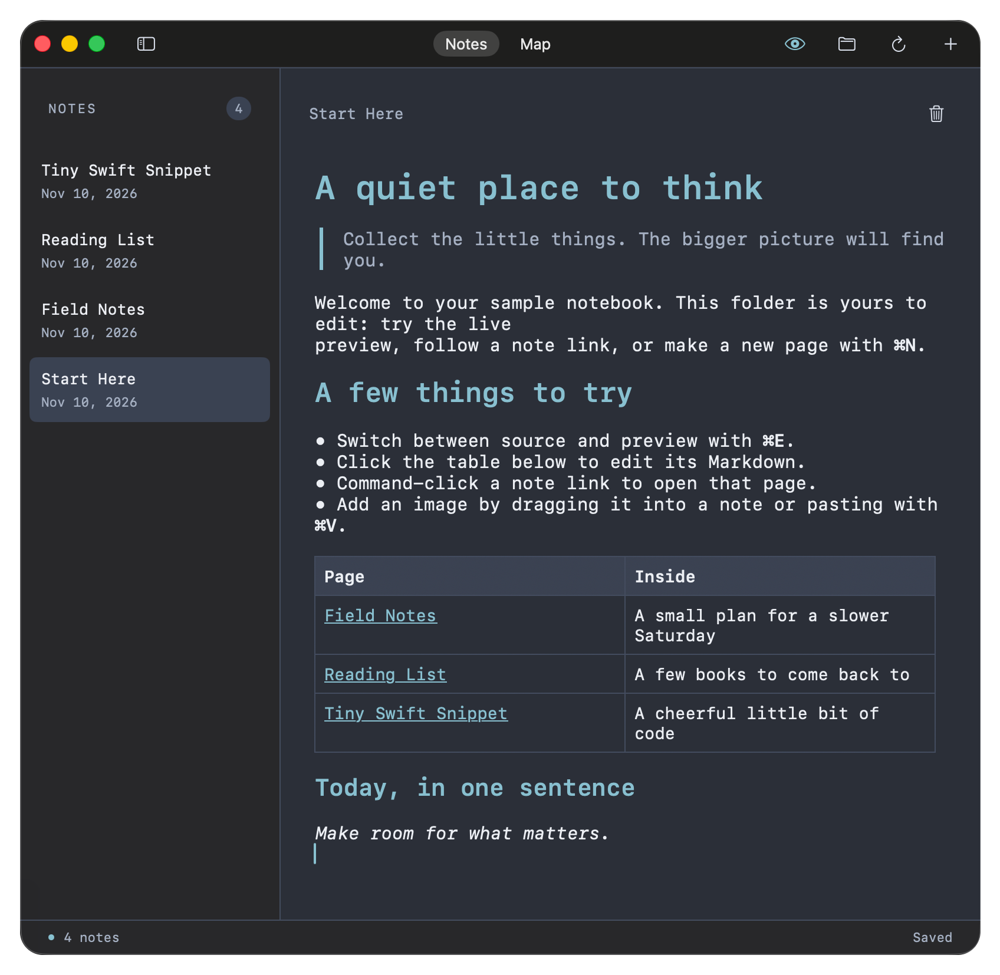

# Nts

**Write your notes. Let AI suggest the title.**

Nts is a native macOS app for writing notes in plain Markdown. Write in your
own words, then ask an optional on-device AI model to suggest a filename as your
note's title. You decide whether to use the suggestion.

## Why Nts?

- **Your notes stay yours.** Notes are regular Markdown files in a folder you
  choose, so they remain easy to move, back up, and open in other apps.
- **Stay focused on writing.** Draft in a native editor, switch to live preview,
  and keep images alongside your notes.
- **Name notes with a little help.** An optional local AI model can suggest a
  title from a new note. It never renames a note without your approval.

## Get started

1. Open Nts and start writing.
2. Choose where to keep your notes with **File → Choose Notes Folder**.
3. Save with **⌘S**. Your notes are saved as Markdown files.
4. To try title suggestions, save a new note and enable suggestions from
   **Local AI → Download Model and Enable Suggestions…**. Review the suggestion
   and choose **Apply** if you want to use it.

The title model requires Apple Silicon and runs on your Mac. Note content and
inference stay on your Mac; the model is downloaded when you request it or
choose to download it in advance. Title suggestions are optional, and Nts works
as a notes app without them.

Nts requires macOS 14 or later. For build and development details, see the
[developer guide](docs/README.md).
